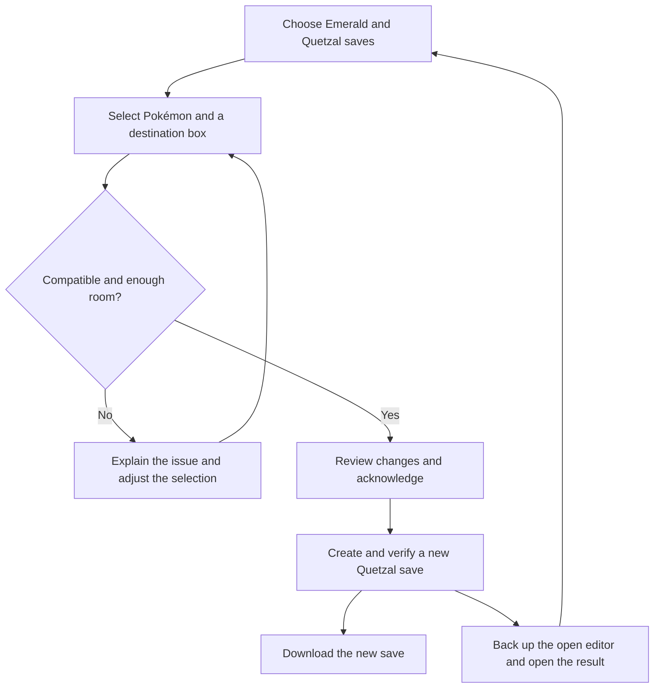
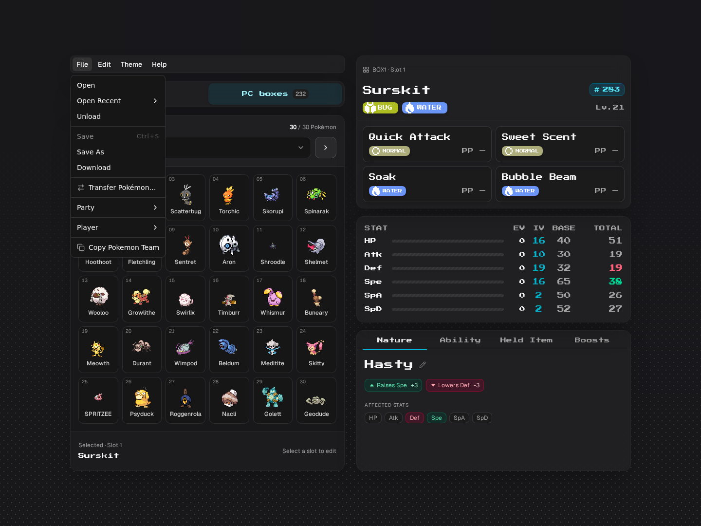
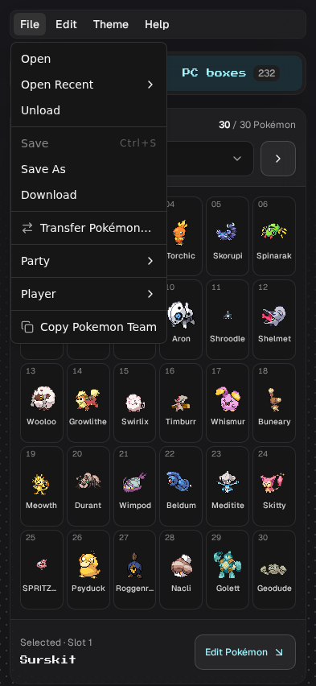
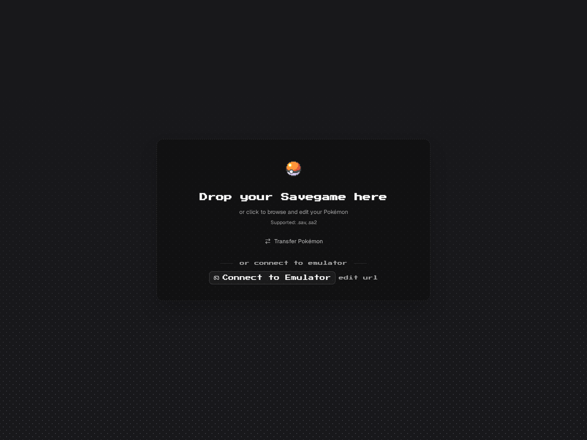
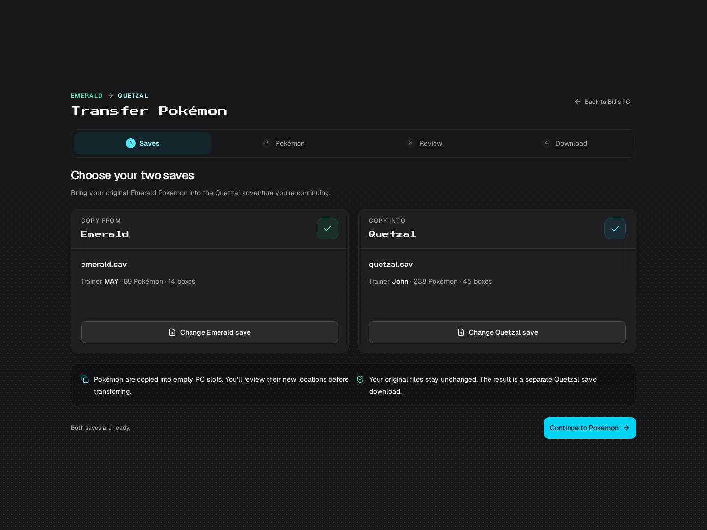
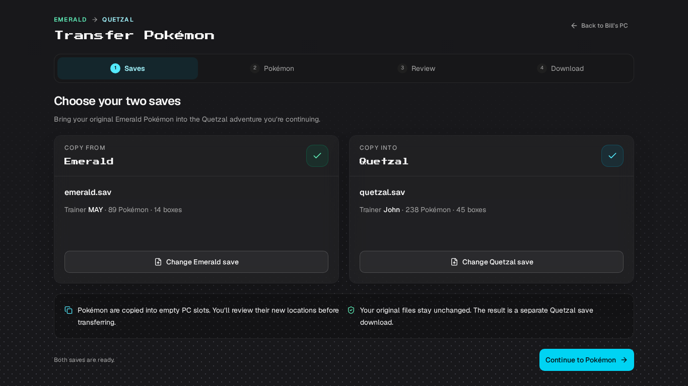
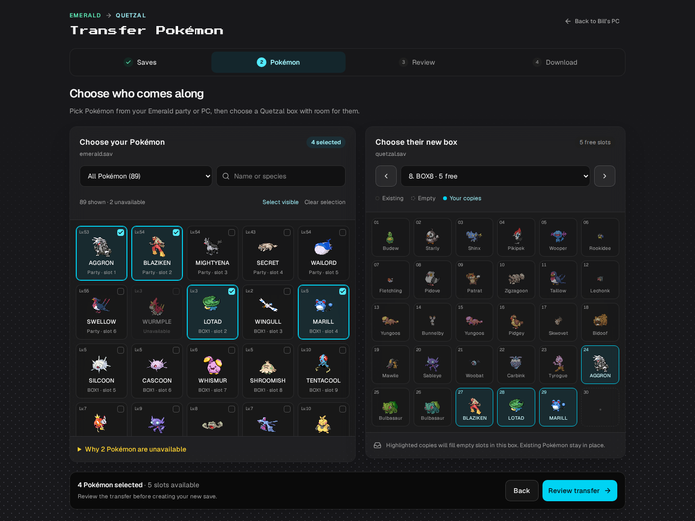
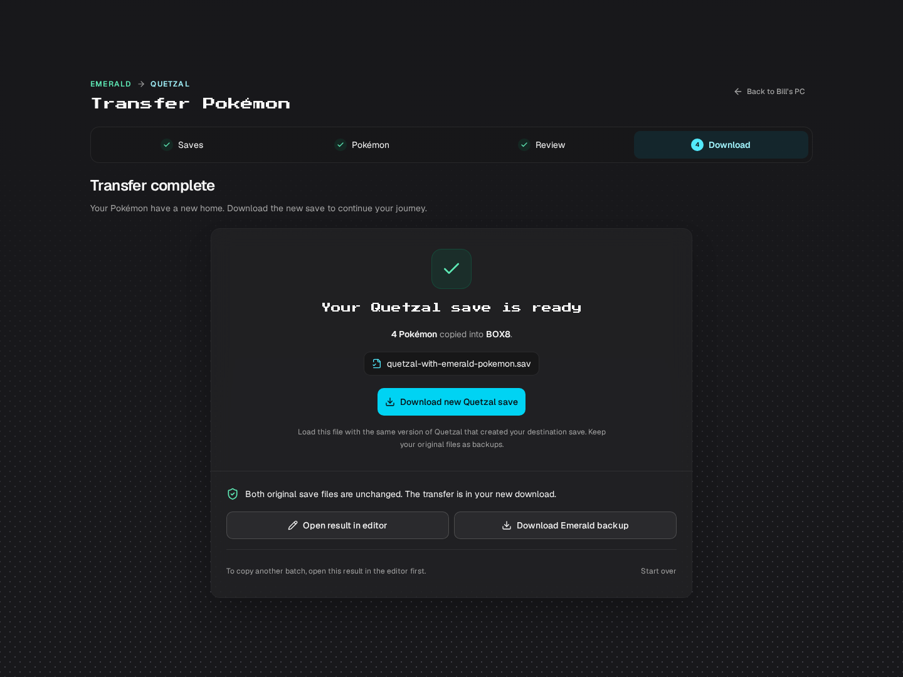
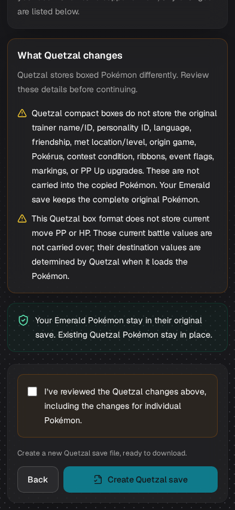

# Bringing an Emerald team into Quetzal

The follow-up to [issue #45](https://github.com/JohnDeved/bills-pc/issues/45#issuecomment-6412244498) asks to continue an old Hoenn journey in Quetzal. This flow makes that a guided copy operation: choose two saves, select Pokémon, see their new locations, review conversion differences, and download a separate Quetzal save.

## User flow

| Step | What the player sees | Behavior |
| --- | --- | --- |
| Entry | **Transfer Pokémon** on the landing screen or **File → Transfer Pokémon…** in the editor | Opens a dedicated workbench. An open file is captured once, including current edits, and prefilled on the correct side. Live emulator sessions are not used as transfer files. |
| 1. Saves | **Copy from Emerald** and **Copy into Quetzal**, with filenames, trainer names, Pokémon counts and box counts | Validates actual save contents. Wrong games, damaged storage and unknown layouts get specific errors. File selection does not replace the current editor. |
| 2. Pokémon | Search by name/species, party/box filter, multi-selection and a destination box preview | Existing occupants stay visible. New copies are highlighted in ascending empty slots. Box options show available capacity. Unsupported Pokémon remain visible with explanations. |
| 3. Review | Every Pokémon's source and assigned slot, what carries over, shared format omissions and expanded individual changes | The Create button requires acknowledgement. Changing files, selection or destination invalidates that acknowledgement. Too many Pokémon or an unsupported conversion prevents export. |
| 4. Download | A distinct filename, **Download new Quetzal save**, **Download Emerald backup**, and an optional editor action | The result is verified before it is offered. Opening it selects the first arrival. If the workbench began with an editor file, the initial edited file is downloaded as a backup before that editor is replaced. |

The close action returns to Bill's PC with its previous editor intact. Selection and review do not write to disk. The result uses a new `File` without the original filesystem write handle. To transfer another batch, open the result and start a new transfer so the next destination includes the previous arrivals.

## Layout and centering

The transfer workbench uses the editor's vertical centering and padding. Every step has equal space above and below when it fits the window. Longer steps grow the document and retain normal scrolling, with 12px mobile / 16px larger-screen padding. Step-heading focus and scrolling remain unchanged.

The remaining transfer-specific spacing has been removed: its 40px desktop top/bottom padding forced otherwise fitting screens to scroll. The latest check records geometry immediately after navigation, without resetting scroll before measurements. Fitting examples:

| Step | Viewport | Top and bottom margins |
| --- | --- | --- |
| Saves | 1366×768 | 30.5px each |
| Pokémon selection | 1440×1080 | 24px each |
| Saves on a taller screen | 1440×1080 | 186.5px each |

All 32 navigation/layout observations passed, including returning from Review and reopening transfer from a scrolled editor. Fitting steps retain zero document scroll. Longer review screens keep all content reachable with the shared padding; no horizontal overflow or browser errors occurred. Build, TypeScript, lint and formatting passed. The [padding verification record](validation/transfer-padding.json) includes source hashes, before/after measurements and overflow checks.

The preceding [full-flow centering record](validation/transfer-centering.json) documents all four steps at desktop, short-desktop and mobile sizes, including the long-review → shorter-completion transition. Each of its three complete browser flows produced the same SHA-256 as the previously verified four-Pokémon transfer; existing destination records, unrelated bytes, original inputs and Emerald backups passed preservation checks.

## Screens

These are actual browser captures using a real Emerald save and the repository's Quetzal save. The transfer screens show Aggron and Blaziken from the party, plus Lotad and Marill from the PC, copied into box 8, slots 24, 27, 28 and 29. Sprite/font responses are genuine cached resources; the conversion itself uses bundled metadata and does not depend on an external API.

### Open transfer from the File menu

In the editor, choose **File → Transfer Pokémon…**. The Party and PC tabs use the full navigation width. The menu action supports keyboard navigation and stays disabled while a save or history operation is loading. The landing screen retains its secondary text button; both entries open the same guided flow.

The Party/PC switch uses the same blurred surface as the editor cards. Switching preserves the positions of the menu, navigation and editor, including on phones. The box header, grid and footer use matching insets; loading details and empty boxes keep the editor's structure stable. See the [layout measurements and regression results](storage-layout-validation.md).

Normal editor, mobile menu and landing screen

### Choose the saves

Centered on a 1366×768 laptop viewport

### Select Pokémon and preview their destination

### Review conversion differences

### Download a separate save

### Mobile review

## Conversion decisions

The originals remain complete. A copied Pokémon must use Quetzal's compact representation, so the review makes its limitations explicit.

| Data | Transfer behavior |
| --- | --- |
| Species, moves, held item and Poké Ball | Map by verified meaning, rather than copying internal game IDs. |
| Ability | Resolve the actual Emerald ability and match its name to the destination species' ability slots. |
| Level, nature, gender, shiny status, IVs | Preserve the supported Pokémon's values. |
| Experience | Convert level and progress to Quetzal's growth curve; round to representable units without changing the level. Exact before/after values appear in review. |
| EVs | Round down to multiples of four, preserving their current stat contribution. Each numerical change is shown. |
| Nickname | Preserve the ten nickname bytes in 31- and 38-byte layouts. The 21-byte layout has no nickname field, so this loss is disclosed individually. |
| Current PP and HP | Present only in the 38-byte layout; clamp to the destination's valid limits and disclose any adjustment. Their omission in other layouts is explicit. |
| OT identity, personality ID, language, friendship, met/origin details, Pokérus, contests, ribbons, event flags, markings, PP Ups and status | The compact format cannot carry these fields. Acknowledgement is mandatory, and the complete Emerald Pokémon stays in its original save/backup. |
| Eggs, damaged records, unsupported encodings/mappings, Mail, held TMs/HMs | Blocked with a reason; the entire selected batch fails safely if it cannot be represented. Remove incompatible held items in Emerald before trying again. |
| Spinda, Unown, Wurmple and Emerald Deoxys | Blocked until their distinctive pattern, form or evolution behavior can be guaranteed for the target format. |

Supported PC layouts contain 21-, 31- or 38-byte records. An entirely empty or ambiguous Quetzal PC cannot identify its layout safely; deposit at least one Pokémon in Quetzal and save first. Compatibility is bounded by the [documented format and metadata provenance](../src/lib/parser/transfer/README.md), not arbitrary modified ROM forks.

## Verification and preservation

Every export is rebuilt from private copies of the two inputs. The reviewed plan is recomputed, records are created atomically, and the output is reparsed before download. Verification checks every existing party/PC Pokémon and every file byte. Only the chosen empty records and their affected sector checksums may differ from the destination snapshot. The other save slot, trainer/progression data, box metadata, padding and auxiliary data must remain unchanged.

Independent SavDex validation covered two real Emerald saves and all supported layouts: **27 cases, 13,670 checks and 537 decoded copies**, with unchanged original input hashes. The real Quetzal capture uses 31-byte records; the 21- and 38-byte cases are explicitly derived fixtures. The actual four-Pokémon browser download separately passed **337 independent checks**, including all 232 existing boxed Pokémon, party records, byte boundaries and checksums. See [the validation record](transfer-validation.md) for inputs, hashes, reproduction and limits.

Desktop and mobile browser tests also exercise wrong-game rejection, full-box protection, acknowledgement invalidation, source-backup equality, download/reopen equality, selection of the first arrival and cancellation. Session tests cover replaced/late uploads, unmount, unsaved editor snapshots, repeated Create clicks and initial-editor backup after either wizard file is replaced. File polling and emulator updates are isolated from a newly opened result.

These checks establish serialization integrity and independent decoding. No emulator play-through was performed, and the destination copy is not a lossless Emerald record. The UI presents those format differences before the user creates it.
