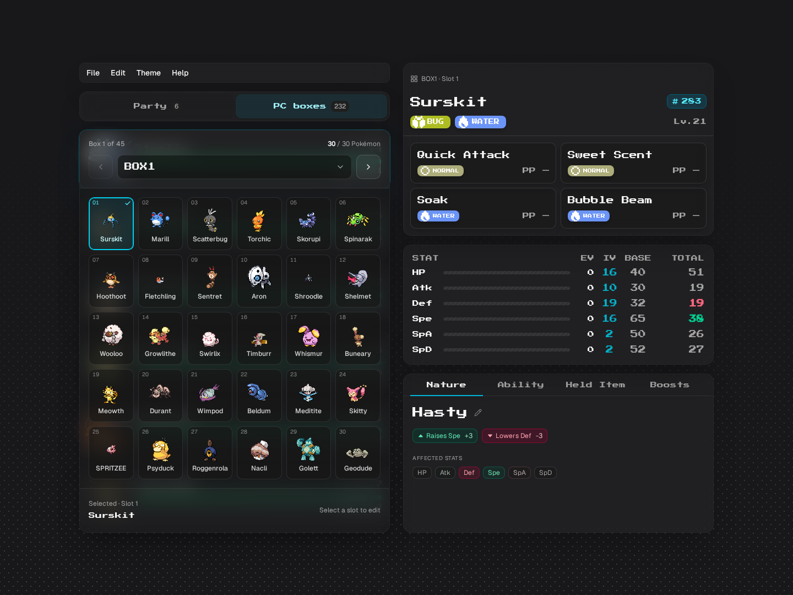
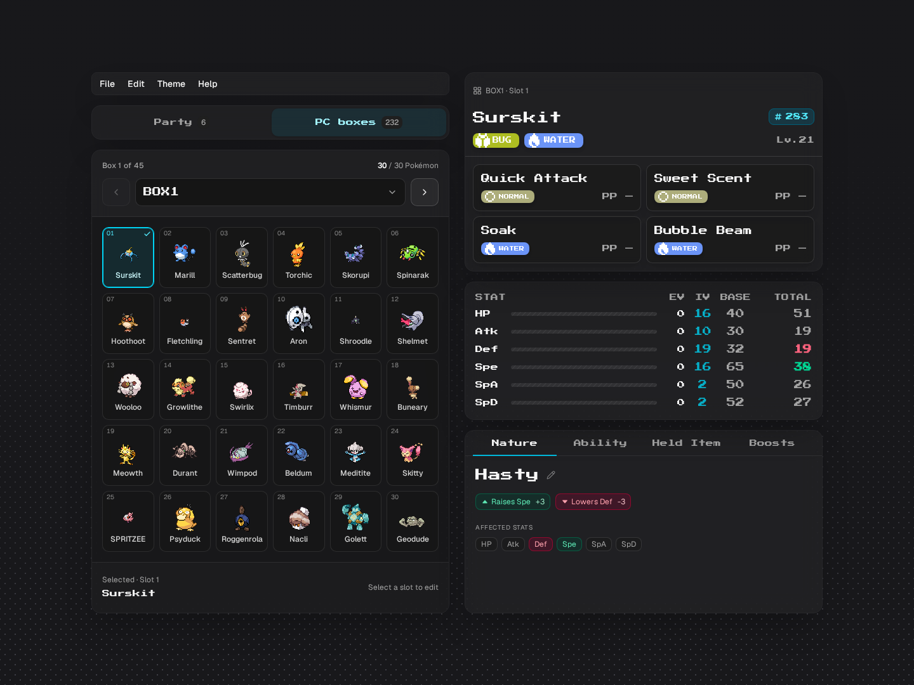
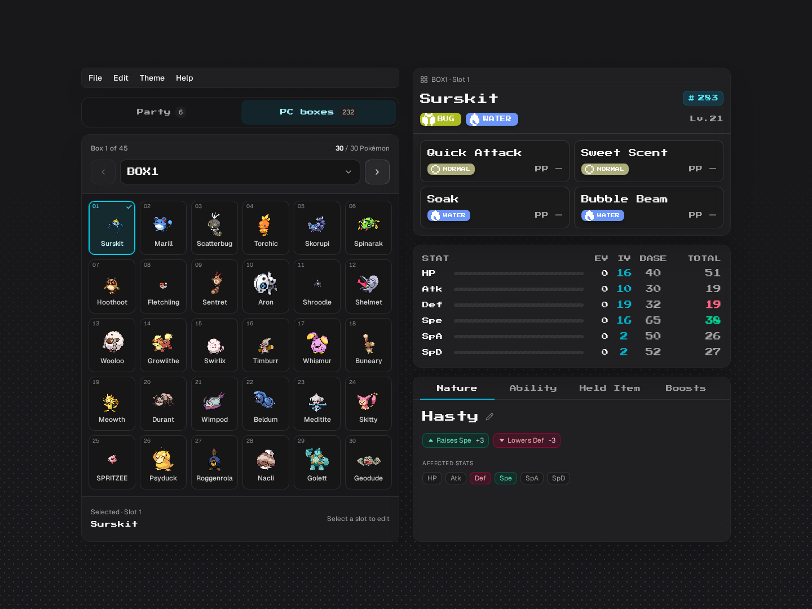
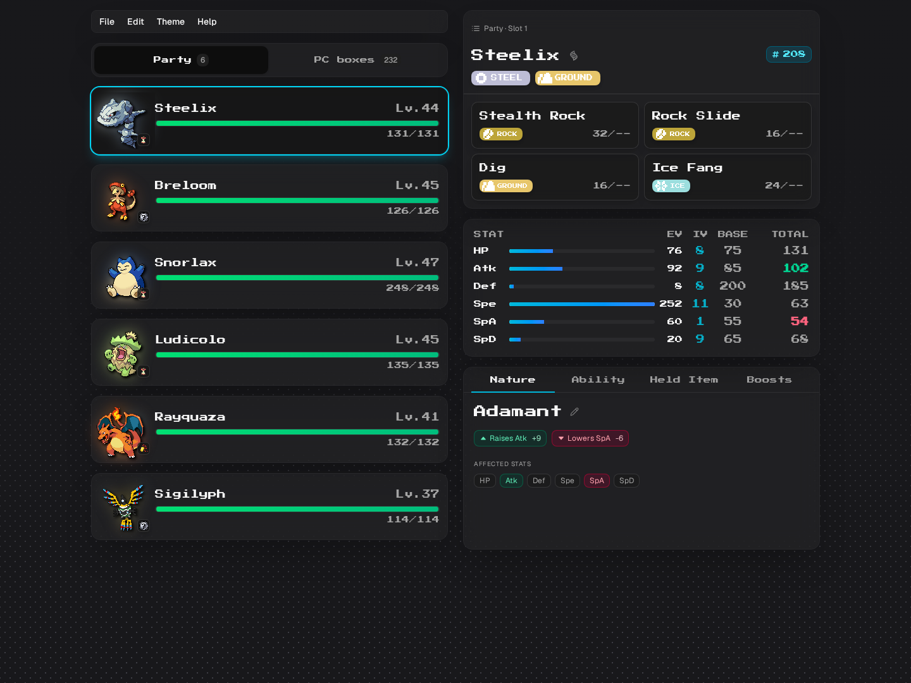
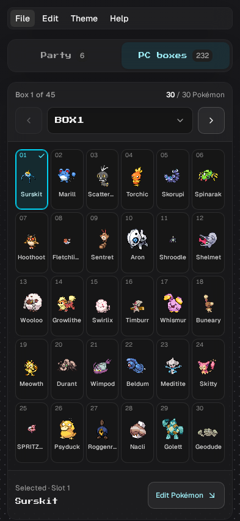
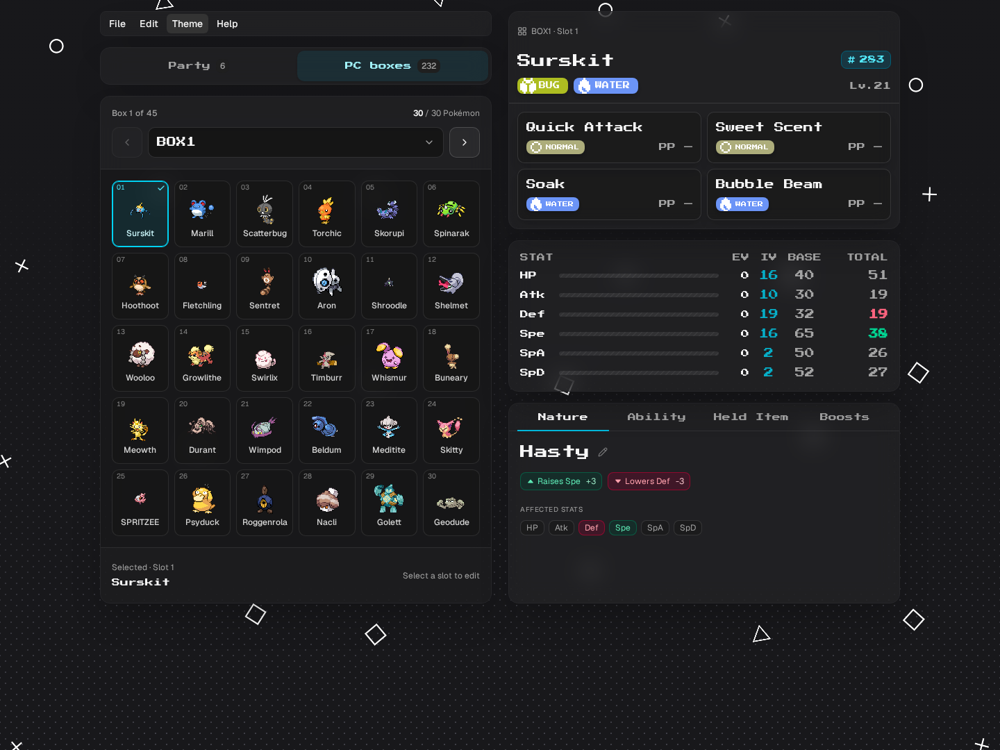

# Party and PC layout validation

The Party/PC switch now uses the shared Card surface, including its 16px backdrop blur, theme colors, border and shadow. Switching no longer vertically recenters the app or pulls the mobile editor upward.

Both storage panels contribute their natural size to one CSS grid area. The inactive panel is invisible, inert and hidden from accessibility navigation. This keeps the available area stable without guessing a fixed panel height. The PC grid fills the shared area, and the party retains its own drag constraints.

The editor keeps its three-card structure for empty boxes. Party and PC use the same location row in the header; populated, loading and empty move cards share the same responsive layout. Long nicknames stay on one line, and multi-form Mega controls fit within the existing header row.

## Vertical centering

The normal editor retains its original vertical centering whenever it fits the viewport. A follow-up restores that alignment after the initial layout fix also anchored the editor to the top. The shared storage sizing and stable editor rows keep Party/PC switching stationary while centered.

The correction was checked with both real saves at 1440×1080, 1440×720, 393×852 and 320×568. All eight cases passed, and all 22 animation-frame traces recorded zero coordinate, size or scroll changes during switching. At 1440×1080, both views have exactly 113.5px above and below. Shorter screens retain 16px desktop / 12px mobile document padding, and all content remains reachable through normal scrolling.

Production build, TypeScript, lint and formatting passed. The [centering verification record](validation/storage-centering.json) contains the tested App source hash, margins and transition results. The desktop screenshots below show the restored centered layout; the broader measurements below document the preceding stability work.

## Immediate tab visibility

A follow-up fixes outgoing UI briefly showing through the incoming panel's blur. The hidden panel itself was already invisible, but its cards, HP bars and buttons used `transition-all`. That also transitions inherited `visibility`, keeping those descendants painted briefly after switching. The original geometry checks did not inspect descendant visibility.

Transitions now name their intended properties: card colors and shadows, HP width, button colors/shadows/opacity, move colors, the Mega icon's filter/opacity, and Nature controls' padding/colors/shadows. Visibility changes immediately. Empty party placeholders have no unnecessary transition. The same correction covers the mounted editor when opening an empty box. Both panels still reserve their natural height, and centering, blur and spacing retain their existing values.

The baseline browser capture reproduced seven Party → PC frames with visible inactive content (up to 72 descendants), and two PC → Party frames (up to six descendants). The fix was verified by inspecting every inactive descendant on each sampled animation frame, with normal animations enabled:

| Verification | Cases | Traces | Sampled frames | Visible inactive content | Layout/scroll movement |
| --- | --- | --- | --- | --- | --- |
| Emerald and Quetzal, desktop and mobile | 4 | 24 | 1,112 | 0 frames | 0px |
| Final Nature transition cleanup, desktop Quetzal | 1 | 7 | 256 | 0 frames | 0px |

The matrix uses 1440×1080 and 393×852 viewports and includes repeated switches, rapid eight-switch sequences, and populated/empty editor transitions on desktop. The focused final run repeats those desktop checks after consolidating Nature's transition declarations and confirms all six stat pills retain their padding and shadow transitions. All tested source hashes stayed unchanged during their respective runs.

The blur remains `blur(16px)`; desktop top and bottom margins remain 113.5px. Both complete reconstructed save files and their original inputs retain their SHA-256 hashes. Production build, TypeScript, lint and formatting passed, with no browser page or resource errors. The [verification record](validation/storage-ghosting.json) includes source hashes, per-trace results, save hashes and the separate matrix/final-check attribution.

These are unmodified browser screencast frames captured during switching, with animations enabled. They illustrate the outgoing party glow and HP bars disappearing; they are not synchronized pixel comparisons.

<details>
<summary>Before and after transition captures</summary>

Before: party content remains visible underneath the PC panel.



After: the inactive party is hidden while the PC panel keeps its normal blur.



</details>

## Measured result

Real Emerald and Quetzal saves were checked at six viewport sizes each:

| Width | Heights |
| --- | --- |
| 1440px | 1080px, 720px |
| 393px | 852px, 600px |
| 320px | 800px, 568px |

| Observation | Before | After |
| --- | --- | --- |
| Menu, tabs and editor movement at 1440 × 1080 | 3.5px upward | 0px |
| Quetzal mobile editor movement when opening PC | 95px upward | 0px |
| Emerald mobile editor movement when opening PC | 103px upward | 0px |
| Switch backdrop filter | None | `blur(16px)` |

All twelve cases had zero changes in the measured coordinates, sizes, page height, document width and scroll position across Party → PC → Party, both at the top and after scrolling. The check tracked the menu, location tabs, storage area, editor and all three editor cards.

Forty-eight frame-by-frame switching traces and twelve populated/empty-box traces checked intermediate frames, including movement after user input that a normal CLS score can omit. Delayed genuine metadata responses were held and released for both games. The inactive panels were excluded from keyboard focus and accessibility queries, and arrow-key switching remained usable.

The real ten-character Scatterbug nickname and a real Charizard nicknamed Rayquaza provided additional narrow-header checks. The latter exposed a 4px selector-height difference: the shared Select primitive's default size overrode its local height class. Setting its supported small size fixed that difference; the final Charizard selection and visible Mega X/Y control checks recorded zero layout movement. One earlier dropdown trace includes Playwright scrolling the trigger into view; its document coordinates and panel dimensions remained unchanged. The final visible-control check avoided that automation scroll.

## Spacing and appearance

| Element | Spacing |
| --- | --- |
| Switch surface inset | 4px, matching the menubar |
| Switch buttons | 8px padding; at least 44px tall |
| Menu, switch and storage gaps | 16px |
| Box header, grid and footer horizontal insets | 12px on phones; 16px from the small breakpoint |
| Outer page padding | 12px on phones; 16px from the small breakpoint |

Dark, light and slate themes were inspected with genuine fonts and sprites. A separate capture enabled the animated shader behind the panels to verify the shared blur treatment.



<details>
<summary>Party, mobile and animated-background captures</summary>







</details>

## Save and interaction regression checks

All eight existing browser cases passed on desktop Chromium and Mobile Chrome with one worker, no retries, no skips and no flaky cases. They cover Emerald and Quetzal box editing, undo/redo, downloads and reopening, Emerald-to-Quetzal transfer, original preservation, and backing up an edited current save before replacement.

All 144 source/configuration hashes stayed unchanged during the final test run. The three input save hashes also stayed unchanged. A separate real mouse drag reordered the Quetzal party; Edit → Undo restored the original identities, order and all 131,088 save bytes. Mega preview changed display values without changing save bytes.

Production build, TypeScript, changed-file formatting and Oxlint passed. Oxlint reported zero warnings and errors.

Run the existing browser regression cases with an installed Playwright Chromium and a populated Emerald save:

```bash
BILLS_PC_EMERALD_SAVE=/absolute/path/to/emerald.sav \
  npx playwright test \
  src/__tests__/box-editing.e2e.test.ts \
  src/__tests__/pokemon-transfer.e2e.test.ts \
  --project=chromium --project="Mobile Chrome" --workers=1
```

The [machine-readable record](validation/storage-layout.json) includes the tested source SHA-256 hashes, before/after geometry, frame-sampling summaries, final selector correction, interaction checks, input hashes and exact E2E results. Its method notes distinguish the full matrix from the focused final correction.

### Existing issue observed separately

The unchanged Mega sprite helper constructs `charizard-megx` / `charizard-megy` filenames instead of `charizard-megax` / `charizard-megay`. A separate visible check observed an unresolved Mega X image and a failed Mega Y remote response. Form selection, types, stats, layout and byte preservation passed; this record does not claim that those Mega sprite assets render correctly.

These are browser and binary-preservation checks. The existing transfer-format limits and absence of a ROM/emulator play-through remain described in [transfer-validation.md](transfer-validation.md).
